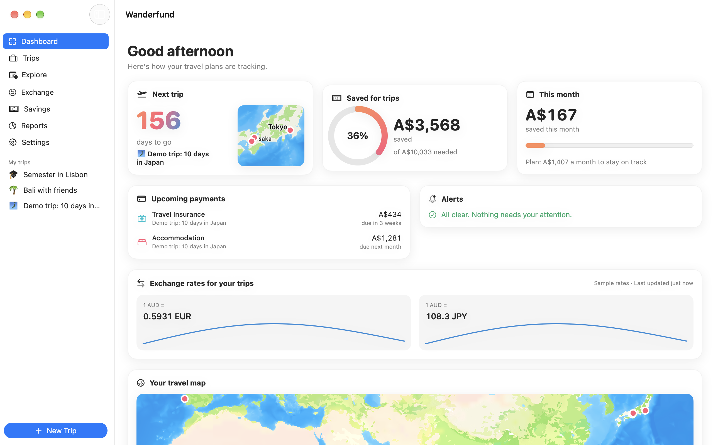
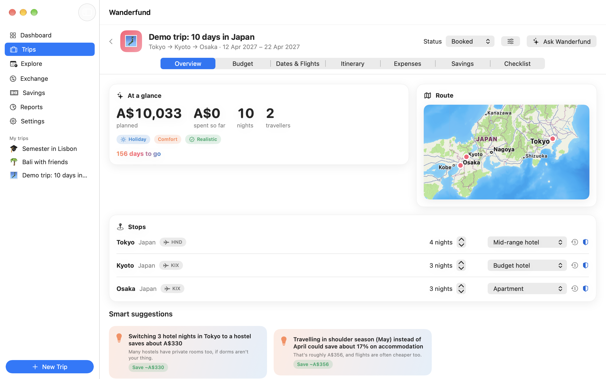
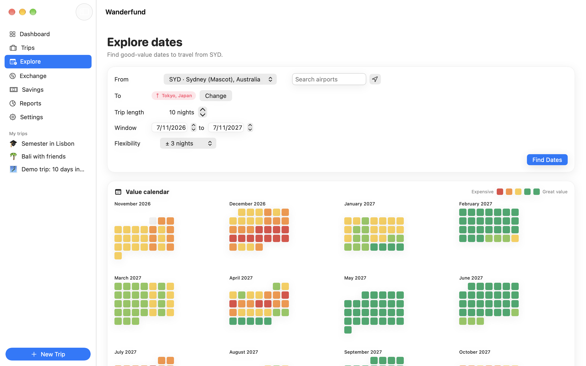
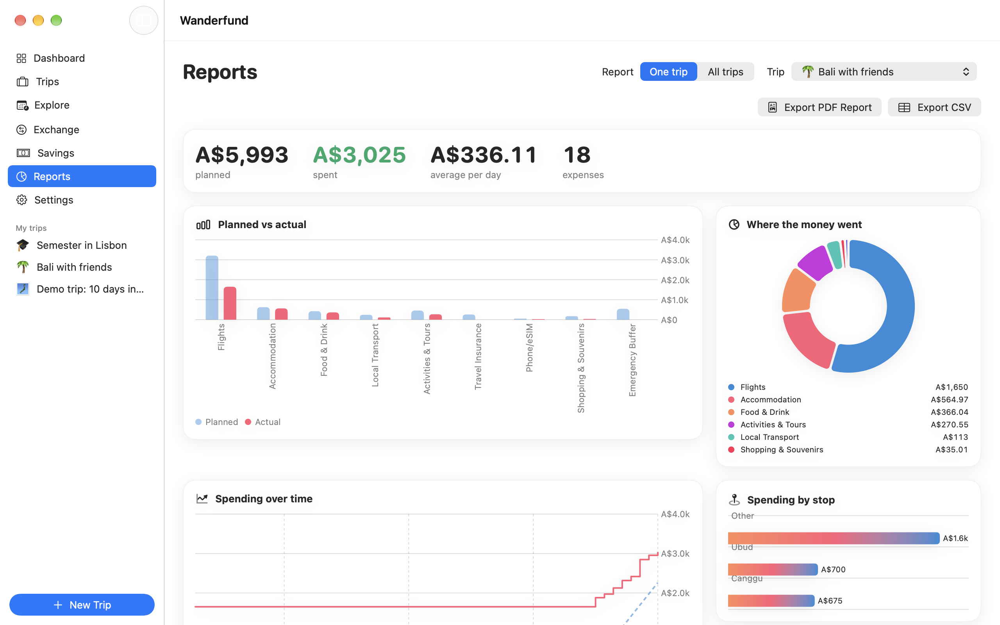
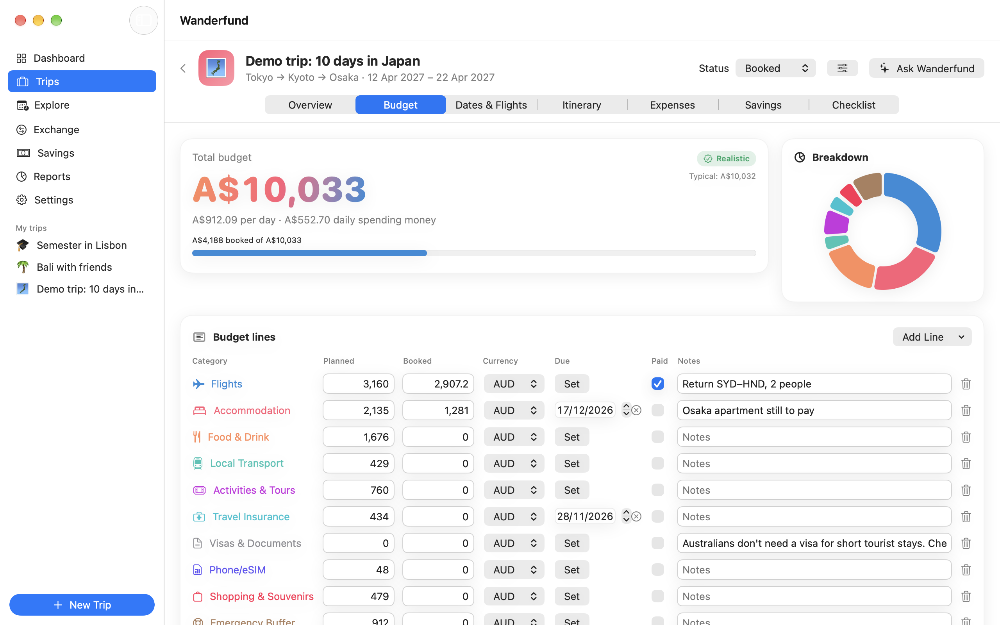

# Wanderfund

**Plan trips, find good-value dates, save towards them and track spending while you're away.**
A friendly travel budgeting app for macOS, built for students and anyone who wants to know what a trip will *really* cost.

  

## Screenshots
| Trip overview and smart suggestions | Good-value dates from your airport |
| --- | --- |
|  |  |
| **Reports** | **Budget** |
|  |  |

## Features
- **Realistic budgets.** A five-step trip wizard and a budget engine with cost estimates for 181 destinations at Backpacker, Comfort and Luxury styles: accommodation, food, transport, activities, flights, insurance, eSIM, shopping and an emergency buffer, in your home currency.
- **Smart suggestions and a reality check.** "Switching 3 hotel nights to a hostel saves about A$340." Every budget is rated Tight, Realistic or Comfortable.
- **Good-value dates.** A 12-month value calendar and the top 5 date windows from your home airport, weighing peak seasons, NSW school holidays, public holidays, typical weather, day of week and booking timing. Add your own SerpApi or Duffel key for live flight prices and daily price watches.
- **Exchange rates.** Live European Central Bank rates, a converter, 90-day charts, rate alerts and a travel money planner.
- **Savings goals.** Weekly targets, projections, a "what if" slider, reminders and confetti at every milestone.
- **Expenses while away.** Any currency, receipt scanning, splitting costs with friends and "settle up", a daily budget tracker and bank CSV import.
- **Study Exchange mode.** A monthly semester budget with income, scholarships and OS-HELP, plus a timeline of key dates.
- **Reports.** Planned vs actual, spending over time and by category or stop, with beautiful PDF reports and CSV export.
- **Itinerary and checklists.** Day-by-day plans with maps, packing lists adjusted for the weather, documents (with passport expiry warnings) and before-you-go tasks.
- **Optional AI assistant.** Add your own Claude API key to ask things like "How can I cut A$300 from this trip?"
- Works offline with saved and bundled data, light and dark mode, VoiceOver and full keyboard support.

## Requirements
- A Mac with Apple Silicon (M1 or later)
- macOS 14 Sonoma or later

## Install
1. [Download Wanderfund.dmg](https://github.com/MilkshakeSR/Wanderfund/releases/latest/download/Wanderfund.dmg) and open it.
2. Drag **Wanderfund** into **Applications**.
3. The first time, **right-click Wanderfund in Applications and choose Open**, then click Open again. Wanderfund isn't notarized by Apple, so macOS asks once.

## Updates
Wanderfund checks for updates once a day and can install them automatically. You can change this, or check now, in **Wanderfund → Settings → Updates**, or choose **Wanderfund → Check for Updates…**.

## Privacy
Your trips, budgets and expenses stay on your Mac. There's no account, analytics or tracking. To work, Wanderfund asks free public services for exchange rates (Frankfurter), public holidays (Nager.Date) and weather history (Open-Meteo), sending only currency codes, country codes and destination coordinates. Flight searches (SerpApi or Duffel) and the AI assistant (Anthropic) are only used if you add your own key, which is stored in your Keychain. Update checks go to GitHub.

Cost figures are estimates to help you plan, not quotes. Always check prices, visas and travel advice (for example on [Smartraveller](https://www.smartraveller.gov.au)) before booking.

## Report a problem
Found a bug or have an idea? [Open an issue](https://github.com/MilkshakeSR/Wanderfund/issues/new), or choose **Help → Report a Problem…** in the app.

## Version history
See [all releases](https://github.com/MilkshakeSR/Wanderfund/releases).

---
Copyright © 2026 Steven Robertson. All rights reserved.
